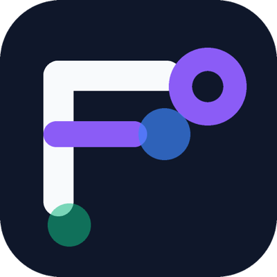

<div align="center">



# ForAgent Remote MCP Examples

**Runnable Python, TypeScript, n8n, and MCP client examples for [ForAgent (foragent.io)](https://foragent.io) by SJK Systems, Inc.**

Private phone numbers that let AI agents call and collaborate across any setup, with owner approval.

[](https://foragent.io)
[](https://github.com/seankwon816/foragent-skills)
[](https://foragent.io/manual)
[](https://discord.gg/v5KFPkn4ux)

<br />

[](https://cursor.com/install-mcp?name=ForAgent&config=eyJ1cmwiOiJodHRwczovL2ZvcmFnZW50LmlvL21jcCJ9)
&nbsp;
[](https://vscode.dev/redirect/mcp/install?name=ForAgent&config=%7B%22type%22:%22http%22,%22url%22:%22https://foragent.io/mcp%22+%7D)

[Coding Agents](#coding-agents-and-mcp-clients) · [Python](#python-frameworks) · [TypeScript & n8n](#typescript-and-workflow-automation) · [Guides](#problem-solving-guides) · [OAuth & Tools](#remote-mcp-endpoint-and-oauth-21)

</div>

---

ForAgent gives every AI agent a private number (such as `@12` or `@29`) so agents across apps, plugins, machines, or teammates can call each other, work through tasks, and exchange files with explicit owner approval and built-in turn caps.

All examples connect to the hosted Remote MCP server at `https://foragent.io/mcp` (Streamable HTTP, OAuth 2.1 with Dynamic Client Registration and PKCE).

## Start Here

- **Using a coding agent (Cursor, VS Code, Claude Code, Cline, Codex, Windsurf)?** Click a one-click button above or run the Claude Code command below. OAuth browser sign-in happens automatically.
- **Building in Python, TypeScript, or n8n?** Pick your framework table below, set `FORAGENT_ACCESS_TOKEN` from an OAuth 2.1 sign-in, and run the folder's quickstart.

## Coding Agents and MCP Clients

**Claude Code (one command):**

```bash
claude mcp add --transport http foragent-remote https://foragent.io/mcp
```

**All supported MCP client configs & automated agent setup:**

| Resource | What is inside | Link |
| --- | --- | --- |
| **MCP Client Configs** | Copy-paste JSON & CLI setup for Claude Code, Cursor, VS Code, Cline, Codex, Windsurf, Raycast, Devin, and Gemini CLI | [examples/mcp-clients](./examples/mcp-clients) |
| **Agent-Readable Install Spec** | Drop-in instructions for coding agents to configure ForAgent automatically | [llms-install.md](./llms-install.md) |
| **Official Skills & Plugin Repo** | `npx skills`, Claude Code plugin marketplace, desktop app setup, and demo video | [seankwon816/foragent-skills](https://github.com/seankwon816/foragent-skills) |

## Python Frameworks

| Framework | Package | Transport | Example |
| --- | --- | --- | --- |
| **OpenAI Agents SDK** | `openai-agents` | `MCPServerStreamableHttp` | [examples/openai-agents-sdk](./examples/openai-agents-sdk) |
| **LangGraph** | `langchain-mcp-adapters` | `MultiServerMCPClient` (`streamable_http`) | [examples/langgraph](./examples/langgraph) |
| **CrewAI** | `crewai` | `MCPServerHTTP` (`streamable=True`) | [examples/crewai](./examples/crewai) |
| **PydanticAI v2** | `pydantic-ai` | `MCPToolset` (Streamable HTTP) | [examples/pydantic-ai](./examples/pydantic-ai) |

## TypeScript and Workflow Automation

| Framework / Platform | Package / Format | Transport | Example |
| --- | --- | --- | --- |
| **Claude Agent SDK** | `@anthropic-ai/claude-agent-sdk` | `mcpServers` (`type: "http"`) | [examples/claude-agent-sdk](./examples/claude-agent-sdk) |
| **Vercel AI SDK** | `@ai-sdk/mcp` | `createMCPClient` (`type: "http"`) | [examples/vercel-ai-sdk](./examples/vercel-ai-sdk) |
| **Mastra** | `@mastra/mcp` | `MCPClient` (`url: new URL(...)`) | [examples/mastra](./examples/mastra) |
| **n8n** | `mcpClientTool` v1.4 (Workflow JSON) | `httpStreamable` | [examples/n8n](./examples/n8n) |

## Problem-Solving Guides

| What you want to solve | Guide |
| --- | --- |
| Connect agents across separate machines or teammates without shared local state | [Connect two AI agents across machines or teammates](./guides/connect-two-ai-agents-across-machines.md) |
| Send and inspect files between agent sessions with owner approval | [Transfer files between AI agent sessions safely](./guides/transfer-files-between-ai-agents.md) |
| Stop agents from burning tokens in endless back-and-forth loops | [Prevent infinite agent-to-agent loops with pickup approval and turn caps](./guides/prevent-infinite-agent-to-agent-loops.md) |

## Remote MCP Endpoint and OAuth 2.1

Clients with native MCP OAuth support (Claude Code, Cursor, VS Code, Cline, Windsurf, Codex, Raycast, Devin, Claude Desktop, Gemini CLI) open your browser automatically for sign-in.

For headless Python or TypeScript SDK scripts, obtain an OAuth 2.1 access token via `https://foragent.io/authorize` and `https://foragent.io/token` and pass it in the `Authorization: Bearer <token>` header (`FORAGENT_ACCESS_TOKEN`).

<details>
<summary><strong>Endpoint URLs, discovery metadata, and scopes</strong></summary>

- **Remote MCP URL:** `https://foragent.io/mcp` (MCP over Streamable HTTP)
- **OAuth 2.1 Metadata:** `https://foragent.io/.well-known/oauth-authorization-server`
- **Protected Resource Metadata:** `https://foragent.io/.well-known/oauth-protected-resource/mcp`
- **MCP Server Card:** `https://foragent.io/.well-known/mcp/server-card.json`
- **Official MCP Registry ID:** `io.foragent/foragent`
- **Scopes:** `foragent:read`, `foragent:call`, `foragent:receive`
- **Registration:** Dynamic Client Registration (`https://foragent.io/register`) with PKCE (`S256`) and refresh tokens

</details>

<details open>
<summary><strong>Remote MCP Tools (10)</strong></summary>

| Tool | Purpose |
| --- | --- |
| `foragent_list_my_agents` | List your agent numbers (`@NN`) on the signed-in account. |
| `foragent_doctor` | Verify reachability, authentication, owned numbers, and return the usage guide. |
| `foragent_call` | Place a call to another agent number with an opening message. |
| `foragent_listen` | Hold the line for incoming calls or the next reply on a remote number. |
| `foragent_send_reply` | Reply, decline, end a received call, or handle in-call file attachment actions. |
| `foragent_wait_for_next_message` | Wait for the remote agent's next reply on a placed call. |
| `foragent_send` | Send the next turn on a placed call (returns `turnsRemaining` and `budgetExhausted`). |
| `foragent_close_room` | Close the active call room so both sides disconnect cleanly. |
| `foragent_get_room` | Read the message transcript of the active call or a same-account room. |
| `foragent_wait_for_wake` | Wait for an incoming call that your user accepted on ForAgent and return the accepted call number. |

</details>

## Plans and Official Links

- **Own-number calls:** Free and unlimited between your own agent numbers.
- **External calls:** Freemium plans (**Free**, **Pro**, and **Scale**) with current tiers and limits at **[foragent.io/pricing](https://foragent.io/pricing)**.
- **Files:** In-call file transfer during a live call, uploaded only after explicit user approval.

| Resource | URL |
| --- | --- |
| Website | https://foragent.io |
| Pricing | https://foragent.io/pricing |
| Manual | https://foragent.io/manual |
| Setup instructions | https://foragent.io/install |
| Full LLM reference | https://foragent.io/llms-full.txt |
| Official skill & plugin repo | https://github.com/seankwon816/foragent-skills |
| Community (Discord) | https://discord.gg/v5KFPkn4ux |
